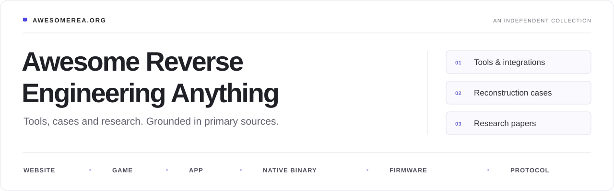

# Awesome Reverse Engineering Anything

A collection of **tools, projects, integrations, and references** for reverse engineering websites, games, apps, native binaries, and firmware.

**[Website](https://awesomerea.org) · [Full repository index](https://awesomerea.org/?view=source-index) · [GitHub](https://github.com/reacher-z/Awesome-REA) · [简体中文](README.zh-CN.md)**

**[Curated directory](https://awesomerea.org/resources/) · [About and review method](https://awesomerea.org/about/)**

An independent collection. Source review is distinct from runtime verification; follow each entry’s primary evidence for tool and research claims.

## Contents

- [Website](#website)
- [Game](#game)
- [App](#app)
- [Native Binary](#native-binary)
- [Firmware and Hardware](#firmware)
- [Agents and MCP](#agents-and-mcp)
- [Related Collections](#related-collections)
- [References and Learning](#references-and-learning)
- [Papers](#papers)
- [Full Repository Index](#full-repository-index)
- [Contributing](#contributing)

## Resources

Each entry appears once under its main purpose. The collection includes independent projects as well as resources for [REA](https://github.com/morluto/rea); inclusion does not imply REA integration.

<!-- BEGIN GENERATED CATALOG -->

### Website

- [webcrack](https://github.com/j4k0xb/webcrack) — Improves JavaScript readability by reversing supported obfuscation patterns and unpacking webpack/Browserify bundles. **[Tool]**
- [WABT](https://github.com/WebAssembly/wabt) — WebAssembly tools for binary-to-text conversion, section inspection, validation, interpretation and C translation. **[Tool · WebAssembly]**
- [wasm-tools](https://github.com/bytecodealliance/wasm-tools) — Bytecode Alliance CLI and Rust libraries for inspecting WebAssembly modules, metadata, components and WIT interfaces. **[Tool · WebAssembly]**
- [Chrome DevTools MCP](https://github.com/ChromeDevTools/chrome-devtools-mcp) — Connect an agent to Chrome for live page inspection, network debugging, and performance traces. **[Integration · Independent MCP]**
- [mitmproxy](https://github.com/mitmproxy/mitmproxy) — Inspect and record HTTP traffic with an interactive proxy, web interface, or scriptable command-line tools. **[Tool]**
- [Playwright MCP](https://github.com/microsoft/playwright-mcp) — Drive browser interactions through structured accessibility snapshots to investigate reproducible web behavior. **[Integration · Independent MCP]**
- [Wakaru](https://github.com/pionxzh/wakaru) — Recover readable modules from shipped JavaScript bundles by reversing recognized minifier and transpiler patterns. Supports bundle splitting and modern-syntax recovery for inspecting production frontend code. **[Tool]**
- [Spectral](https://github.com/spectral-mcp/spectral) — Analyze captured application HTTP traffic with an LLM to generate MCP tools, OpenAPI 3.1 specifications, or GraphQL schemas. Generated tools call the observed API directly after capture and authentication setup. **[Integration · Independent agent]**
- [jsdeob-workbench](https://github.com/Owl4444/jsdeob-workbench) — Inspect JavaScript ASTs and variable scopes while building visual chains of Babel transforms. Save analysis projects and reusable plugins to iteratively simplify obfuscated scripts. **[Tool]**
- [Browser Reverse Engineering Toolkit](https://github.com/Dvurechensky/Browser.Reverse.Engineering.Toolkit) — Capture browser-session evidence, crawl websites in a persistent Chromium session, and generate offline architecture/API reports plus OpenAPI, SDK and mock-server drafts from saved captures. **[Tool]**

### Game

- [DX-Ball: reconstruct sound panning](https://rea.tools/showcase/dx-ball/) — Recover one sound-pan function from instructions and constants; upstream cites 3,205 cases and a 63-byte match. **[Case study · REA]**
- [TH04: recover a DOS bullet-ring helper](https://rea.tools/showcase/th04/) — Inspect a 16-bit PC-98 DOS helper and relate its angle calculation to a pinned reconstruction and historical compiler checks. **[Case study · REA]**
- [RenderDoc](https://github.com/baldurk/renderdoc) — Inspect frame captures, draw calls, shaders, and graphics resources in your own game or graphics application. **[Tool]**
- [AssetRipper](https://github.com/AssetRipper/AssetRipper) — Analyze Unity game files, inspect asset dependencies, and convert supported assets into Unity project formats. **[Tool]**
- [Cpp2IL](https://github.com/SamboyCoding/Cpp2IL) — Recover managed representations from Unity IL2CPP builds using binary and metadata analysis; reconstruction remains a work in progress. **[Tool]**
- [Il2CppDumper](https://github.com/Perfare/Il2CppDumper) — Recover IL2CPP metadata and dummy assemblies, and generate helper scripts for native analysis tools; method code is not restored. **[Tool]**
- [RenderDoc MCP](https://github.com/scarletfantasy/renderdoc-mcp) — Expose existing RenderDoc captures to an agent for bounded frame, pipeline, resource, and shader inspection. **[Integration · Independent MCP]**
- [UndertaleModTool](https://github.com/UnderminersTeam/UndertaleModTool) — Browse and modify supported GameMaker data files, extract assets, and decompile or compile GML VM code. Includes room editing, scripted changes, a CLI, and the reusable UndertaleModLib library. **[Tool]**
- [frida-il2cpp-bridge](https://github.com/vfsfitvnm/frida-il2cpp-bridge) — Inspect IL2CPP classes, methods, and fields in a live process, and trace or intercept method calls without supplying global-metadata.dat. Complements static IL2CPP dumpers with runtime observation. **[Tool]**
- [objdiff](https://github.com/encounter/objdiff) — Compare functions and data in reference and rebuilt object files to guide matching decompilation. Displays instruction-level differences, demangles C++ symbols, and can rebuild when source files change. **[Tool]**
- [UE Explorer](https://github.com/UE-Explorer/UE-Explorer) — Explore Unreal packages through class, property, and dependency trees; decompile and export UnrealScript classes, inspect bytecode, and examine structured binary data. **[Tool]**
- [GARbro](https://github.com/morkt/GARbro) — Browse recognized visual-novel resource archives as folders, preview their contents, and extract images or audio with conversion to common formats. **[Tool]**
- [LASRecomp: Link’s Awakening static recompilation](https://github.com/peiikai/LASRecomp) — A native desktop reconstruction of the 2019 Switch version of Link’s Awakening using static recompilation. The author attributes most code, tooling and reverse-engineering work to Claude Code with human direction and review. **[Case study · Independent reconstruction]**
- [Godot RE Tools](https://github.com/GDRETools/gdsdecomp) — Recover supported Godot project files, GDScript and imported resources from exported games. Includes PCK inspection and extraction, script decompilation, and resource conversion for examining and rebuilding project structure. **[Tool]**
- [UE4SS](https://github.com/UE4SS-RE/RE-UE4SS) — Inspect Unreal Engine games at runtime through live UObject property views, reflected C++ header dumps, property mappings and actor dumps. Lua and C++ APIs support experiments while reconstructing game structures. **[Tool]**
- [FModel](https://github.com/4sval/FModel) — Explore Unreal Engine game archives with CUE4Parse-backed package and property inspection, asset previews and export. The 2026 summer release adds USD world export for reconstructing supported scene content. **[Tool]**
- [PSP Web Recomp](https://github.com/snuri00/psp-web-recomp) — Translate PSP MIPS executables into C++ and WebAssembly, backed by a PSP high-level emulation runtime and WebGL2 renderer. Native tracing, frame capture and audio tools support investigating missing behavior during game porting. **[Project]**

### App

- [Aegis: trace a login-code calculation](https://rea.tools/showcase/aegis/) — An official APK investigation follows TOTP methods in Aegis and publishes artifact identities and selected Evidence. **[Case study · REA]**
- [Notion: trace the clipboard bridge](https://rea.tools/showcase/notion/) — Trace a packaged Electron clipboard path using REA findings and separate source inspection; the dynamic wrapper remains a stated limit. **[Case study · REA]**
- [ReaCut: video-editor reconstruction](https://github.com/Xiangyu-CAS/rea-capcut) — An independent video editor whose authors document REA-assisted investigation of Jianying/CapCut behavior and project formats. The public implementation includes a local timeline, FFmpeg export and an experimental, lossy draft importer. **[Case study · Mixed workflow]**
- [JADX-AI-MCP](https://github.com/zinja-coder/jadx-ai-mcp) — JADX plugin paired with a Python MCP server to inspect decompiled Android classes, resources, cross-references and debugger context. **[Integration · Independent MCP]**
- [frida-mcp (yfe404)](https://github.com/yfe404/frida-mcp) — Frida MCP server with persistent instrumentation sessions, runtime inspection and Android static-to-dynamic navigation. **[Integration · Independent MCP]**
- [Super Trouper](https://github.com/crissyfield/super-trouper) — Single-binary Frida MCP server for discovering devices, managing process sessions and loading instrumentation scripts. **[Integration · Independent MCP]**
- [Frida](https://github.com/frida/frida) — Dynamic instrumentation toolkit for observing and scripting the behavior of live native and managed processes. **[Tool]**
- [JADX](https://github.com/skylot/jadx) — Dex-to-Java decompiler with CLI/GUI navigation, resource decoding and cross-reference search for Android packages. **[Tool · Android]**
- [Apktool](https://github.com/iBotPeaches/Apktool) — Decodes Android resources and smali into a project-like tree and can rebuild modified packages. **[Tool · Android]**
- [Androguard](https://github.com/androguard/androguard) — Python toolkit for APK/DEX metadata, bytecode and reference analysis; the v5 source branch also documents agent skills and MCP. **[Tool · Android]**
- [ILSpy](https://github.com/icsharpcode/ILSpy) — .NET assembly browser and C# decompiler with whole-project export, metadata inspection and a scriptable command-line frontend. **[Tool · .NET]**
- [dnSpyEx](https://github.com/dnSpyEx/dnSpy) — Community continuation of dnSpy for debugging and editing .NET assemblies without the original source. **[Tool · .NET]**
- [@electron/asar](https://github.com/electron/asar) — Electron's archive tool lists and extracts ASAR contents so packaged JavaScript and application assets can be inspected. **[Tool]**
- [Mobile Security Framework (MobSF)](https://github.com/MobSF/Mobile-Security-Framework-MobSF) — Inspect mobile application packages with static analysis and supported-device dynamic testing, including runtime behavior and network traffic, through a web interface and APIs. **[Tool · Android]**
- [Blutter](https://github.com/worawit/blutter) — Analyze Flutter Android ARM64 AOT binaries using the matching Dart runtime. Produces annotated assembly, object-pool dumps and a target-specific Frida script template for investigating compiled Dart application logic. **[Tool · Android]**
- [hermes-dec](https://github.com/P1sec/hermes-dec) — Parse, disassemble and partially decompile React Native Hermes bytecode bundles. Makes HBC headers and instructions inspectable and emits pseudocode for understanding compiled application logic. **[Tool]**
- [Recaf](https://github.com/Col-E/Recaf) — Inspect and modify compiled JVM applications with integrated decompilers, bytecode assembly, reference search, mappings and deobfuscation tools. The reviewed 4.0 preview also provides basic read-only Android bytecode inspection. **[Tool · JVM]**
- [nibkit](https://github.com/tokenbleed/nibkit) — Decode compiled iOS/macOS interface archives into object trees, Outlet/Action connections, custom classes and navigation relationships. Exports JSON or Mermaid diagrams and exposes read-only inspection commands through MCP. **[Tool]**
- [AOTopsy](https://github.com/BroNils/aotopsy) — Statically inspect Flutter/Dart AOT libapp.so files to recover available metadata, class structures, call edges and pseudocode without embedding a Dart VM or compiling a matching SDK. Supports ARM64 and x86_64 analysis paths. **[Tool · Android]**
- [hbctool](https://github.com/bongtrop/hbctool) — Disassemble and reassemble supported React Native Hermes bytecode bundles through HASM files, enabling bytecode inspection and editing for the explicitly supported legacy HBC versions. **[Tool · Android]**

### Native Binary

- [DownUnderCTF: masked-squares flag checker](https://rea.tools/showcase/ctf/) — An official educational challenge investigation connects binary checks to equations and records an original-program validation. **[Case study · REA]**
- [Ghidra](https://github.com/NationalSecurityAgency/ghidra) — Open-source analysis suite for disassembly, decompilation, graphs and Java/Python automation across executable formats. **[Tool]**
- [radare2](https://github.com/radareorg/radare2) — Scriptable command-line framework for inspecting, disassembling, debugging and modifying binaries across many architectures. **[Tool]**
- [Cutter](https://github.com/rizinorg/cutter) — Rizin-powered graphical reverse-engineering workspace with extensible views and Ghidra decompiler integration. **[Tool]**
- [Qiling](https://github.com/qilingframework/qiling) — Python emulation framework that adds OS, filesystem and API behavior around CPU emulation for instrumented binary analysis. **[Tool]**
- [Unicorn Engine](https://github.com/unicorn-engine/unicorn) — Multi-architecture CPU emulator for executing selected instruction ranges with register, memory and hook control. **[Tool · Library]**
- [angr](https://github.com/angr/angr) — Python binary-analysis framework combining control-flow recovery, symbolic execution, data-flow analysis and decompilation. **[Tool · Library]**
- [LIEF](https://github.com/lief-project/LIEF) — Library for structured parsing and modification of executable formats including ELF, PE and Mach-O. **[Tool · Library]**
- [Capstone](https://github.com/capstone-engine/capstone) — Disassembly library with architecture-neutral APIs and instruction details for custom binary-analysis pipelines. **[Tool · Library]**
- [ImHex](https://github.com/WerWolv/ImHex) — Hex editor with a binary-pattern language, structured data inspection and visual tools for understanding file formats. **[Tool]**
- [x64dbg](https://github.com/x64dbg/x64dbg) — Windows binary debugger with disassembly, memory views and plugins for analyzing programs without source code. **[Tool]**
- [GDB](https://sourceware.org/gdb/) — Native and remote debugger for controlling execution and inspecting live or crashed program state. **[Tool]**
- [rr](https://github.com/rr-debugger/rr) — Records process execution and replays it under GDB, enabling repeatable inspection and reverse execution. **[Tool]**
- [Diaphora](https://github.com/joxeankoret/diaphora) — IDA-based binary diffing that matches functions and transfers names, comments and types between analyzed versions. **[Tool]**
- [BinDiff](https://github.com/google/bindiff) — Compares disassembled binaries to find matching functions and changed code across versions. **[Tool]**
- [Detect It Easy](https://github.com/horsicq/Detect-It-Easy) — Format-aware file identification and static inspection using parsers, signatures and programmable heuristics. **[Tool]**
- [objection](https://github.com/sensepost/objection) — Explore running Android and iOS apps with a Frida-backed command interface for inspecting app storage, memory, runtime objects, and instrumented behavior. **[Tool]**
- [r2frida](https://github.com/nowsecure/r2frida) — Use radare2 commands and Frida instrumentation together to inspect local or remote process memory, symbols, classes, and runtime calls on desktop and mobile targets. **[Tool]**
- [Kaitai Struct](https://github.com/kaitai-io/kaitai_struct) — Turn documented binary layouts into reusable parsers for files and network packets. A .ksy specification can be inspected with visualizers and compiled to multiple languages, helping preserve reverse-engineered format knowledge in interoperable implementations. **[Tool · Library]**
- [Wireshark](https://gitlab.com/wireshark/wireshark) — Inspect captured application and device traffic as decoded protocol fields, with filtering and shared GUI/TShark dissection. Custom dissectors let an analyst encode newly understood packet formats and compare protocol implementations. **[Tool]**

### Firmware and Hardware

- [PicoPrint: LX-D02 printer investigation](https://github.com/bigtower17/picoprint) — The author describes REA-assisted Android investigation followed by separate Hermes decompilation to support a Windows BLE printer. **[Case study · Mixed workflow]**
- [Binwalk](https://github.com/ReFirmLabs/binwalk) — Identifies embedded formats and optionally extracts their contents, with entropy analysis for firmware triage. **[Tool]**
- [unblob](https://github.com/onekey-sec/unblob) — Recursively extracts archives and filesystems from binary blobs while reporting chunk boundaries and unknown regions. **[Tool]**
- [Ghidra Firmware Utilities](https://github.com/al3xtjames/ghidra-firmware-utils) — Ghidra loaders and helpers for PCI option ROMs, UEFI firmware volumes, Intel flash descriptors and coreboot images. **[Tool]**
- [EMBA](https://github.com/e-m-b-a/emba) — Extract firmware, combine static checks with emulation-based analysis, inventory software components, and generate web reports and SBOMs for further investigation. **[Tool]**
- [Firmware Analysis and Comparison Tool (FACT)](https://github.com/fkie-cad/FACT_core) — Unpack and analyze firmware through an extensible platform whose web interface and HTTP API make component contents and analysis results searchable and comparable across samples. **[Tool]**
- [OFRAK](https://github.com/redballoonsecurity/ofrak) — Recursively identify, unpack, analyze, modify, and repack firmware and binary formats using a resource-tree GUI and Python API, with optional disassembler backends. **[Tool]**
- [FirmAE](https://github.com/pr0v3rbs/FirmAE) — Emulate router and IP-camera firmware to inspect network services and runtime behavior, with automated emulation checks and separate analysis, run, and debugging modes. **[Tool]**
- [PulseView](https://github.com/sigrokproject/pulseview) — Examine captured logic and analog waveforms with sigrok's graphical frontend. Protocol decoders and decoder stacking expose bus messages and higher-level device operations, making hardware communication traces useful for firmware and interoperability investigations. **[Tool]**
- [UEFITool](https://github.com/LongSoft/UEFITool) — Parse UEFI firmware images into an inspectable tree and check their structure. Companion UEFIExtract and UEFIFind tools extract parsed contents and locate patterns, supporting analysis of firmware components and vendor formats. **[Tool]**

### Agents and MCP

- [REA — Reverse Engineer Anything](https://github.com/morluto/rea) — The upstream CLI and MCP server for evidence-based investigations of shipped software and runtime behavior. **[Project · REA]**
- [Official reverse-engineer-anything skill](https://github.com/morluto/rea/tree/main/.agents/skills/reverse-engineer-anything) — Target routing, connection recovery and evidence practices for agents using REA. **[Integration · REA]**
- [dsh-mcp-rea](https://github.com/Ersith/dsh-mcp-rea) — A community MCP bridge presents a smaller selected tool surface and forwards explicit commands to the REA CLI. **[Integration · REA]**
- [rea-jev](https://github.com/juan-viox/rea-jev) — A Claude Code plugin adds Jev-based routing and evidence checks around a pinned REA MCP integration. **[Integration · REA]**
- [rea-casebook](https://github.com/pablodiazjorge/rea-casebook) — A Claude Code mod collects received REA Evidence, tracks unknowns and records findings that cite delivered evidence IDs. **[Integration · REA]**
- [Hex-Rays IDA MCP](https://github.com/HexRaysSA/ida-mcp) — Official Hex-Rays MCP server for agent access to IDA databases, with headless operation and optional GUI integration. **[Integration · Independent MCP]**
- [GhidraMCP](https://github.com/LaurieWired/GhidraMCP) — Ghidra extension and MCP bridge exposing decompilation, symbol navigation and renaming to agents, with GUI and headless modes. **[Integration · Independent MCP]**
- [Binary Ninja MCP (official)](https://dev-docs.binary.ninja/guide/mcp.html) — Binary Ninja's own MCP interface exposes functions, symbols, disassembly, intermediate languages and decompiled text to agents. **[Integration · Independent MCP]**
- [Binary Ninja MCP (fosdickio)](https://github.com/fosdickio/binary_ninja_mcp) — Community Binary Ninja plugin and bridge for MCP clients, including workflows that switch among multiple open binaries. **[Integration · Independent MCP]**
- [IDA Pro MCP (mrexodia)](https://github.com/mrexodia/ida-pro-mcp) — Community IDA integration useful for existing setups and migration context; its maintainer now recommends the official Hex-Rays MCP server. **[Integration · Independent MCP]**
- [Radare2 MCP Server](https://github.com/radareorg/radare2-mcp) — Native radare2 MCP server offering binary-analysis tools, reusable sessions and configurable read-only access. **[Integration · Independent MCP]**
- [r2ai](https://github.com/radareorg/r2ai) — AI plugins inside radare2 for function explanations, naming suggestions and model-assisted decompilation using local or remote models. **[Integration · Independent agent]**
- [DAILA](https://github.com/mahaloz/DAILA) — Decompiler-independent AI assistant for function summaries and naming across IDA, Ghidra, Binary Ninja and angr-management. **[Integration · Independent agent]**
- [RevEng.AI Ghidra Plugin](https://github.com/RevEngAI/plugin-ghidra) — Connects Ghidra to RevEng.AI for function similarity, recovered names, AI explanations and agent-assisted annotation. **[Integration · Independent agent]**
- [LLDB MCP](https://lldb.llvm.org/use/mcp.html) — LLDB's official MCP interface gives agents debugger sessions and commands for breakpoints, memory inspection and stepping. **[Integration · Independent MCP]**
- [Claude Reverse Engineering Skill](https://github.com/EncidXVII/claude-reverse-engineering-skill) — Community agent skill for triage, headless exports and evidence-based RE reports; explicitly documents workflows with REA and other MCP servers. **[Integration · Independent agent]**
- [SpecterOps Reverse Engineering Skills](https://github.com/SpecterOps/skills/tree/main/plugins/reverse-engineering) — Focused Binary Ninja and Ghidra analysis skills that describe MCP tool use, analysis recipes and annotation practices. **[Integration · Independent agent]**

### Related Collections

- [Awesome Reverse Engineering](https://github.com/morluto/awesome-reverse-engineering) — A task-oriented reverse-engineering resource list by REA's maintainer, useful for broader tools and foundations. **[Collection]**
- [Awesome REA Cases](https://github.com/songshikang0111/awesome-REA-cases) — A bilingual collection of REA and other AI-assisted reverse engineering cases, with source links and explicit distinctions between reported and reproduced outcomes. **[Collection]**

### References and Learning

- [Installation and client setup](https://github.com/morluto/rea/blob/main/docs/installation.md) — Reviewed setup plans, client registration, provider prerequisites and scoped readiness checks. **[Documentation · REA]**
- [CLI and Evidence](https://github.com/morluto/rea/blob/main/docs/cli.md) — CLI workflows for saving Evidence and projecting smaller views from completed analysis. **[Documentation · REA]**
- [MCP contracts and generated catalog](https://github.com/morluto/rea/blob/main/docs/mcp-contracts.md#generated-catalog) — Canonical tool contracts, provider discovery and Evidence semantics for integration authors. **[Documentation · REA]**
- [Native binary investigation](https://github.com/morluto/rea/blob/main/docs/native-investigation.md) — Locate a function, inspect instructions and pseudocode, and follow references with a selected native provider. **[Documentation · REA]**
- [Cross-layer JavaScript application workflows](https://github.com/morluto/rea/blob/main/docs/javascript-application-workflows.md) — Trace features and compare authenticated JavaScript application graphs while preserving static-analysis limits. **[Documentation · REA]**
- [Static Android APK analysis](https://github.com/morluto/rea/blob/main/docs/android-analysis.md) — Inspect Android package identity, classes, methods and references through REA's JADX integration. **[Documentation · REA]**
- [Managed-code analysis](https://github.com/morluto/rea/blob/main/docs/managed-code-analysis.md) — Read PE/CLI metadata and CIL, compare managed members and inspect declared native boundaries without loading the assembly. **[Documentation · REA]**
- [Historical web network captures](https://github.com/morluto/rea/blob/main/docs/web-network-captures.md) — Inspect saved web captures offline; recorded URLs are not fetched and no proxy is started. **[Documentation · REA]**
- [Firmware analysis](https://github.com/morluto/rea/blob/main/docs/firmware-analysis.md) — Inspect firmware regions with Binwalk and explicitly extract with Unblob, retaining tool and artifact identity. **[Documentation · REA]**
- [Browser observation guide](https://rea.tools/guides/browser/) — Follow a user-triggered export request in the supplied Notes browser example and connect it to the downloaded result. **[Documentation · REA]**
- [JavaScript and Electron: follow a CSV export](https://rea.tools/guides/javascript/) — A source-owned Notes fixture teaches the renderer, preload, IPC and CSV path with linked analysis evidence. **[Documentation · REA]**
- [rea-playbook](https://github.com/jinshi666888/rea-playbook) — An Electron practice target, Evidence extractor and MCP probe; offline fixture mode is distinguished from real REA analysis. **[Learning resource]**
- [rea-lab](https://github.com/pablodiazjorge/rea-lab) — A Windows REA/Ghidra lab with seeded challenges, published studies, upstream contributions and recorded limitations. **[Research]**
- [OpenSecurityTraining2](https://ost2.fyi/) — Free self-paced security courses with learning paths for reverse engineering, firmware and systems foundations. **[Learning resource]**
- [pwn.college: Reverse Engineering](https://pwn.college/program-security/reverse-engineering/) — Hands-on reverse-engineering module covering functions, data access, static tools and dynamic tools with hosted exercises. **[Learning resource]**
- [Reverse Engineering for Beginners](https://beginners.re/) — Dennis Yurichev's free book on understanding compiled programs and assembly, available in multiple languages. **[Learning resource]**
- [The Official Radare2 Book](https://book.rada.re/) — Official practical reference for radare2 analysis, disassembly, scripting, debugging and related plugins. **[Learning resource]**
- [LLM4Decompile (EMNLP 2024)](https://aclanthology.org/2024.emnlp-main.203/) — Research on direct binary decompilation and refinement of Ghidra output with language models. Evaluates re-executability on HumanEval and ExeBench; useful for distinguishing readable output from functional recovery. **[Research]**
- [DecompileBench (Findings of ACL 2025)](https://aclanthology.org/2025.findings-acl.1194/) — A benchmark combining functions from real programs, runtime-aware validation, and LLM-assisted assessment of decompiled-code usability. Helps separate functional correctness from perceived understandability when comparing decompilers. **[Research]**
- [ReSym (CCS 2024)](https://doi.org/10.1145/3658644.3670340) — Combines language models and program analysis to recover variable and user-defined data-structure symbols from stripped binaries. The authors provide training, inference, evaluation, and posterior-reasoning artifacts. **[Research]**
<!-- END GENERATED CATALOG -->

<!-- BEGIN GENERATED PAPERS -->

## Papers

A bibliography of **25 papers** on reverse-engineering agent evaluation, decompilation, firmware analysis, and website, game, and app reconstruction. Some papers also appear among curated resources; counts are not additive. Publication status and study scope are made explicit.

[Browse the paper directory](https://awesomerea.org/papers/) · [Complete bibliography JSON](data/papers.json) · [Suggest a paper](https://github.com/reacher-z/Awesome-REA/issues/new?template=paper.yml)

### Reverse-engineering agent evaluation

- [Humans vs. Machines: A Comparison With AI Agents in Software Reverse Engineering](https://arxiv.org/abs/2610.14960) — **2026 · arXiv · Preprint**

    Samuele Doria et al. · [PDF](https://arxiv.org/pdf/2610.14960)

    Compares human and LLM-agent understanding and navigation on the same static reverse-engineering challenges, then studies how binary representations consume context windows.

    **Scope and limits:** Understanding is graded on two compact challenges; the separate 4,000-binary study measures context capacity, not task-solving accuracy. The interface is static IDA/MCP without dynamic execution, and prior exposure to challenge source remains an acknowledged validity threat.

- [The Next Challenge for Agentic Cybersecurity: A Realistic, Contamination-Free Reverse Engineering Benchmark](https://arxiv.org/abs/2608.11469) — **2026 · arXiv · Preprint**

    Jeremy Spence et al. · [PDF](https://arxiv.org/pdf/2608.11469)

    Introduces SRE-Bench, with privately authored programs and protected binary variants, to study agent recovery of program semantics while reducing training-data contamination.

    **Scope and limits:** The revised study reports 19 programs, 262 binary instances, and 1,572 graded tasks. Binaries and task instances are not publicly released; access is through an evaluation service. Its contamination-control claim is the authors' methodology, not an independent guarantee.

- [CrackMeBench: Binary Reverse Engineering for Agents](https://arxiv.org/abs/2605.10597) — **2026 · arXiv · Preprint**

    Isaac David et al. · [PDF](https://arxiv.org/pdf/2605.10597)

    Evaluates agents on executable-checked CrackMe tasks: infer validation logic from binaries and submit an accepted input or artifact, while recording tool use, time, and scoring attempts.

    **Scope and limits:** The v0 study uses 12 generated tasks and eight public calibration tasks, Linux x86-64 ELF binaries, a shell interface, and a five-minute budget. Its compact educational tasks do not establish performance on large applications. No paper-linked public artifact URL was verified.

- [ProgramBench: Can Language Models Rebuild Programs From Scratch?](https://arxiv.org/abs/2605.03546) — **2026 · NeurIPS 2026 · Accepted**

    John Yang et al. · [PDF](https://arxiv.org/pdf/2605.03546v1) · [Code](https://github.com/facebookresearch/ProgramBench)

    Evaluates black-box program reconstruction across 200 tasks: agents query an executable and read its documentation, then independently implement a codebase whose behavior is checked by generated tests.

    **Scope and limits:** Binary inspection, decompilation, and internet access are forbidden during inference. Passing finite tests does not prove complete behavioral equivalence or recovery of the original source. Later live-leaderboard runs are separate from the reviewed arXiv results.

- [CREBench: Evaluating Large Language Models in Cryptographic Binary Reverse Engineering](https://arxiv.org/abs/2604.03750) — **2026 · COLM 2026 · Accepted**

    Baicheng Chen et al. · [PDF](https://arxiv.org/pdf/2604.03750) · [Code](https://github.com/wangyu-ovo/CREBench)

    Benchmarks cryptographic binary reverse engineering across algorithm recognition, key or IV extraction, wrapper reconstruction, and flag recovery using 432 controlled challenges.

    **Scope and limits:** The corpus combines 48 algorithms, three insecure key-use scenarios, and three difficulty levels. It excludes professional-grade obfuscators such as Tigress and O-LLVM; results should not be generalized to heavily protected arbitrary binaries.

### Decompilation and symbol recovery

- [DecompileBench: A Comprehensive Benchmark for Evaluating Decompilers in Real-World Scenarios](https://aclanthology.org/2025.findings-acl.1194/) — **2025 · Findings of ACL 2025 · Conference paper**

    Zeyu Gao et al. · [PDF](https://aclanthology.org/2025.findings-acl.1194.pdf) · [Code](https://github.com/vul337/DecompileBench)

    Evaluates traditional and LLM-based decompilers using functions from real programs, runtime behavioral checks, and an LLM-assisted assessment of analyst-facing code understandability.

    **Scope and limits:** The evaluated corpus has 23,400 functions from 130 programs. Fuzzing-based checks have finite coverage, and understandability scores depend partly on an LLM judge. The artifact warns that rebuilt OSS-Fuzz projects can differ from the paper's versions.

- [Decompile-Bench: Million-Scale Binary-Source Function Pairs for Real-World Binary Decompilation](https://papers.nips.cc/paper_files/paper/2025/hash/079cf13ae174c31f148207d94d213bdc-Abstract-Datasets_and_Benchmarks_Track.html) — **2025 · NeurIPS 2025 Datasets and Benchmarks · Conference paper**

    Hanzhuo Tan et al. · [PDF](https://papers.nips.cc/paper_files/paper/2025/file/079cf13ae174c31f148207d94d213bdc-Paper-Datasets_and_Benchmarks_Track.pdf) · [Code](https://github.com/albertan017/LLM4Decompile)

    Introduces two million C/C++ binary-source function pairs using a Compile-Trace-Filter pipeline, with an evaluation suite spanning translated HumanEval/MBPP tasks and recent GitHub functions.

    **Scope and limits:** This is function-level decompilation. Re-execution tests cover HumanEval/MBPP; GitHub2025 provides no unit tests. Inlining can prevent one-to-one source correspondence, and the fine-tuning study uses 10% of the corpus. These results do not establish whole-program recovery.

- [LLM4Decompile: Decompiling Binary Code with Large Language Models](https://aclanthology.org/2024.emnlp-main.203/) — **2024 · EMNLP 2024 · Conference paper**

    Hanzhuo Tan et al. · [PDF](https://aclanthology.org/2024.emnlp-main.203.pdf) · [Code](https://github.com/albertan017/LLM4Decompile)

    Trains language models for assembly-to-C decompilation and for refining Ghidra pseudocode, evaluating whether recovered functions can be recompiled and executed correctly.

    **Scope and limits:** The paper limits its experiments to C on x86 and function-level benchmarks. Re-executability on sampled tests does not establish whole-program equivalence or recovery of the original source. Later repository releases are separate from the 2024 paper.

- [ReSym: Harnessing LLMs to Recover Variable and Data Structure Symbols from Stripped Binaries](https://doi.org/10.1145/3658644.3670340) — **2024 · ACM CCS 2024 · Conference paper**

    Danning Xie et al. · [PDF](https://www.cs.purdue.edu/homes/lintan/publications/resym-ccs24.pdf) · [Code](https://github.com/lt-asset/resym)

    Combines two fine-tuned language models with Prolog-based cross-function reasoning to infer local-variable symbols and user-defined data structures from stripped-binary decompilation.

    **Scope and limits:** The method depends on underlying decompilation and learned predictions over C/C++ data. Cross-checking reduces conflicting predictions but does not prove that recovered names or layouts match the unavailable source. The public artifact includes models, processed data, and evaluation code.

- [Augmenting Decompiler Output with Learned Variable Names and Types](https://www.usenix.org/conference/usenixsecurity22/presentation/chen-qibin) — **2022 · USENIX Security 2022 · Conference paper**

    Qibin Chen et al. · [PDF](https://arxiv.org/pdf/2108.06363) · [Code](https://github.com/CMUSTRUDEL/DIRTY)

    Introduces DIRTY, a Transformer model that recommends variable names and types from decompiled code and layout information, together with the DIRT corpus for training and evaluation.

    **Scope and limits:** The original pipeline is built around C programs and Hex-Rays output. Predicted names and types are learned hypotheses, not guaranteed original symbols. The published paper is from 2022, although its arXiv preprint first appeared in 2021.

- [DIRE: A Neural Approach to Decompiled Identifier Naming](https://arxiv.org/abs/1909.09029) — **2019 · ASE 2019 · Conference paper**

    Jeremy Lacomis et al. · [PDF](https://arxiv.org/pdf/1909.09029) · [Code](https://github.com/pcyin/dire)

    Combines lexical and structural information from decompiler output to predict meaningful variable names, with a training and evaluation corpus derived from compiled C projects.

    **Scope and limits:** This is learned identifier naming, not complete source reconstruction or an autonomous agent. Its reported results concern an x86-64 C corpus and depend on decompiler output. The original author repository is deprecated and points to a successor.

### Website reconstruction

- [Dashboard2Code: Evaluating Multimodal Models on Reconstructing Interactive Dashboards](https://aclanthology.org/2026.acl-long.1750/) — **2026 · ACL 2026 · Conference paper**

    Tianhao Niu et al. · [PDF](https://aclanthology.org/2026.acl-long.1750.pdf) · [Code](https://github.com/nth2000/Dashboard2Code)

    Evaluates agents that actively explore a running dashboard and reconstruct its appearance and interaction logic. DashboardMimic provides 180 Plotly+Dash examples, with code-semantic analysis and dynamic interaction tests for the generated implementations.

    **Scope and limits:** Limited to Plotly+Dash dashboards, including model-augmented examples. Some settings expose DOM information and evaluation uses model judges. This is not a general backend-recovery benchmark. The linked dataset requires accepting access conditions and sharing contact information.

- [IWR-Bench: Can LVLMs reconstruct interactive webpage from a user interaction video?](https://proceedings.iclr.cc/paper_files/paper/2026/hash/55bfedfd31489e5ae83c9ce8eec7b0e1-Abstract-Conference.html) — **2026 · ICLR 2026 · Conference paper**

    Yang Chen et al. · [PDF](https://proceedings.iclr.cc/paper_files/paper/2026/file/55bfedfd31489e5ae83c9ce8eec7b0e1-Paper-Conference.pdf) · [Code](https://github.com/SIGMME/IWR-Bench)

    Tests reconstruction of interactive webpages from user-interaction videos and supplied static assets. Its 113 tasks replay annotated action sequences to assess visual fidelity and functional behavior across observed page states.

    **Scope and limits:** The required output is one HTML file; the paper explicitly instructs models to mock implied backend logic with static JavaScript data. Trajectory coverage and model-based judgments do not prove complete website or backend equivalence.

- [Interaction2Code: Benchmarking MLLM-based Interactive Webpage Code Generation from Interactive Prototyping](https://doi.org/10.1109/ASE63991.2025.00028) — **2025 · ASE 2025 · Conference paper**

    Jingyu Xiao et al. · [PDF](https://arxiv.org/pdf/2411.03292v3) · [Code](https://github.com/WebPAI/Interaction2Code)

    Benchmarks reconstruction of interactive webpages from screenshots before and after an interaction. The final study covers 127 webpages and 374 interactions, comparing rendered appearance, automated interaction checks, and human usability judgments.

    **Scope and limits:** The inputs specify individual interaction transitions, not autonomous exploration of a complete site. Its tests do not establish long-workflow, server-side, or original-source equivalence; a detectable interaction is not necessarily usable.

- [WebUIBench: A Comprehensive Benchmark for Evaluating Multimodal Large Language Models in WebUI-to-Code](https://aclanthology.org/2025.findings-acl.815/) — **2025 · Findings of ACL 2025 · Conference paper**

    Zhiyu Lin et al. · [PDF](https://aclanthology.org/2025.findings-acl.815.pdf)

    Diagnoses webpage-to-code capability through visual perception, HTML programming, image-to-HTML understanding, and screenshot reconstruction tasks. It separates underlying skills using question-answer pairs derived from real websites.

    **Scope and limits:** Primarily evaluates visual and HTML reconstruction skills. The paper includes a preliminary interaction study, not a full workflow or backend-equivalence benchmark. The official repository currently exposes README and images but not the evaluation scripts described in its instructions.

- [Design2Code: Benchmarking Multimodal Code Generation for Automated Front-End Engineering](https://aclanthology.org/2025.naacl-long.199/) — **2025 · NAACL 2025 · Conference paper**

    Chenglei Si et al. · [PDF](https://aclanthology.org/2025.naacl-long.199.pdf) · [Code](https://github.com/NoviScl/Design2Code)

    Evaluates reconstruction of frontend code from webpage screenshots using real-world reference pages, visual-element and layout metrics, and human assessment.

    **Scope and limits:** This is visual website reconstruction, not binary decompilation or recovery of backend behavior and interactive workflows. The main benchmark contains 484 webpages with placeholder images; code and data have separate licensing terms.

### Game reconstruction and reverse engineering

- [GameReplica: A Benchmark for Black-Box Visual Game Replication by Vision-Language Agents](https://arxiv.org/abs/2609.22308) — **2026 · arXiv · Preprint**

    Boyu Qiao et al. · [PDF](https://arxiv.org/pdf/2609.22308v1)

    Evaluates whether vision-language agents can infer hidden game rules through screenshots and active interaction, then build runnable single-file HTML replicas across 125 tasks from 25 web games, each with five difficulty levels.

    **Scope and limits:** The tasks cover rule-driven web puzzles and board games, not native or commercial game reconstruction. Rule, implementation, and visual scores use LLM judges and do not prove behavioral equivalence. The official site provides demos; a benchmark-code repository was not verified.

- [RevengeBench: Reverse Engineering Code-Space Policies from Behavioral Experiments](https://arxiv.org/abs/2606.26094) — **2026 · arXiv · Preprint**

    Babak Rahmani et al. · [PDF](https://arxiv.org/pdf/2606.26094v1) · [Code](https://github.com/bethgelab/revenge-bench)

    Tests whether agents can recover executable decision policies from behavioral traces and self-designed opponent probes, using 75 synthetic policies across five game arenas and measuring held-out action agreement and downstream competitive value.

    **Scope and limits:** The targets are fixed synthetic policies, not full games or adaptive adversaries. Agreement on finitely evaluated states does not uniquely identify source code, and some arenas have substantial variance. The public package omits some paper-only plotting and ablation suites; reproduction also needs CodeClash, a container runtime, and model access.

- [SPRITE: From Static Mockups to Engine-Ready Game UI](https://doi.org/10.1145/3772363.3798742) — **2026 · CHI EA 2026 (poster/extended abstract) · Conference paper**

    Yunshu Bai et al. · [PDF](https://baiyunshu.github.io/sprite.github.io/Source/chiea26-516.pdf)

    Transforms game-interface screenshots into editable engine assets through hierarchical YAML, visual grounding, asset extraction, and Unity UXML/USS synthesis, with evaluation on a curated game-UI benchmark and review by three senior UI/UX designers.

    **Scope and limits:** The generated interactions cover basic hover, toggle, and click behavior. Complex temporal and drag-and-drop logic remain outside scope, and translucent overlap or ambiguous diegetic layouts can fail. This is game-UI prototyping, not complete gameplay reconstruction; the official page still labels code as coming soon.

### App reconstruction and analysis

- [DeclarUI: Bridging Design and Development with Automated Declarative UI Code Generation](https://doi.org/10.1145/3715726) — **2025 · Proceedings of the ACM on Software Engineering · Journal article**

    Ting Zhou et al. · [PDF](https://xinyi-hou.github.io/files/zhou2024bridging.pdf) · [Code](https://github.com/security-pride/DeclarUI)

    Combines visual component extraction, multimodal models, page-transition graphs and iterative checks to reconstruct multi-page mobile UI code from designs or screenshots, evaluated with React Native, Flutter and ArkUI.

    **Scope and limits:** People review and correct the inferred navigation graph. Evaluation covers 50 five-page UI sets; transition coverage and compilation do not establish full business-logic or backend recovery. Framework results vary, and visual metrics imperfectly reflect perceived fidelity. Public scripts and data are available, but no project-level license was found at the reviewed commit.

- [Machine Learning-Based Prototyping of Graphical User Interfaces for Mobile Apps](https://doi.org/10.1109/TSE.2018.2844788) — **2020 · IEEE Transactions on Software Engineering · Journal article**

    Kevin Moran et al. · [PDF](https://arxiv.org/pdf/1802.02312v2)

    ReDraw turns screenshots or design mock-ups into native Android GUI prototypes by detecting components, classifying widget types with a CNN, and assembling a plausible view hierarchy with a data-driven nearest-neighbor method.

    **Scope and limits:** The implementation covers 15 Android component classes and one screen at a time; multiple screens require manual combination, and hierarchy construction is tied to the mined screen size. Evaluation concerns appearance and view hierarchy, not recovery of original app logic or backends. Screenshots and reconstructed mock-ups served as proxies for real design artifacts; results were not independently reproduced here.

- [pix2code: Generating Code from a Graphical User Interface Screenshot](https://doi.org/10.1145/3220134.3220135) — **2018 · EICS 2018 · Conference paper**

    Tony Beltramelli · [PDF](https://arxiv.org/pdf/1705.07962v2) · [Code](https://github.com/tonybeltramelli/pix2code)

    Learns screenshot-to-DSL generation for native Android XML, iOS Storyboards and web HTML/CSS interfaces, then compiles the DSL into platform UI code.

    **Scope and limits:** Evaluation uses synthetic screenshot/code pairs: 1,500 training and 250 test instances per platform. Reported accuracy concerns DSL tokens, not complete apps or behavior. Text labels are ignored; platform datasets train separate models using the same architecture. The task covers layout, components and relationships, not application logic or backend recovery. The repository describes an educational research prototype; its older dependencies were not runtime-tested.

- [Reverse Engineering Mobile Application User Interfaces with REMAUI (T)](https://ieeexplore.ieee.org/abstract/document/7372013) — **2015 · ASE 2015 · Conference paper**

    Tuan Anh Nguyen et al. · [PDF](https://c.csallner.org/papers/nguyen15reverse.pdf) · [Code](https://github.com/soumikmohianuta/pixtoapp)

    Reconstructs native Android UI code from screenshots or design bitmaps using OCR, computer vision, and layout heuristics; evaluates visual similarity and view hierarchies on 488 screenshots from over 100 Android and iOS applications.

    **Scope and limits:** The output is Android UI code; iOS screenshots are inputs, not evidence of native iOS output. Original logic and backend behavior are not recovered, and multi-screen transitions were future work. OCR/layout heuristics can misidentify content. The linked REMAUI v2 repository has older dependencies and is not the exact verified 2015 artifact.

### Firmware analysis and rehosting

- [Fuzzware: Using Precise MMIO Modeling for Effective Firmware Fuzzing](https://www.usenix.org/conference/usenixsecurity22/presentation/scharnowski) — **2022 · USENIX Security 2022 · Conference paper**

    Tobias Scharnowski et al. · [PDF](https://www.usenix.org/system/files/sec22-scharnowski.pdf) · [Code](https://github.com/fuzzware-fuzzer/fuzzware)

    Rehosts monolithic ARM Cortex-M firmware for fuzzing, using locally scoped symbolic execution to model memory-mapped I/O accesses and focus input mutations on values relevant to firmware logic.

    **Scope and limits:** The Cortex-M3/M4 artifact requires memory-map configuration and does not automatically model DMA. Abstracting hardware can produce crashes that are impossible on the physical device. This is an analysis environment, not original-source recovery or faithful full-device reconstruction.

- [FirmAE: Towards Large-Scale Emulation of IoT Firmware for Dynamic Analysis](https://doi.org/10.1145/3427228.3427294) — **2020 · ACSAC 2020 · Conference paper**

    Mingeun Kim et al. · [PDF](https://syssec.kaist.ac.kr/pub/2020/kim_acsac2020.pdf) · [Code](https://github.com/pr0v3rbs/FirmAE)

    Extends Firmadyne with empirically derived interventions for boot, networking, NVRAM, kernel behavior, and other runtime failures, enabling Linux router and IP-camera firmware web services to run for dynamic analysis.

    **Scope and limits:** Arbitration deliberately changes execution and targets functioning web interfaces, not identical physical-device behavior. The evaluation covers ARM little-endian and MIPS little-/big-endian firmware from routers and IP cameras; heuristics may fail on unseen devices or configurations. It reuses firmware binaries rather than recovering their source.
<!-- END GENERATED PAPERS -->

## Full Repository Index

<!-- BEGIN REPOSITORY INDEX SUMMARY -->
**3,000** repository READMEs scanned; **2,864** entries available to browse. The 136 clearly out-of-scope entries remain in the scan data. This automatically discovered index is separate from the curated resources above and has not been individually execution-tested.

[Browse by category on GitHub](docs/repositories/README.md) · [Search website](https://awesomerea.org/?view=source-index&lang=en) · [Full bilingual index JSON](https://awesomerea.org/source-index.json) · [Curated catalog JSON](https://awesomerea.org/catalog.json)
<!-- END REPOSITORY INDEX SUMMARY -->

The resource list above is curated from primary sources. Detailed requirements, original evidence, and review dates are available in the [catalog data](data/README.md).

## Contributing

New tools, projects, case studies, and collections are welcome. Suggest a resource or improve an existing entry through the [contribution guide](CONTRIBUTING.md). Use a project link, a concise description, and an accurate resource type.

## About

For software made with AI and resources for training or evaluating agents, browse [AI Can What?](https://aicanwhat.com/) across games, websites, and applications.

This is an independent community collection. Original descriptions and code are [MIT licensed](LICENSE); linked projects retain their own licenses.

[Supporting documentation](data/README.md) · [Repository scanning method](docs/source-scan.md)
